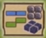
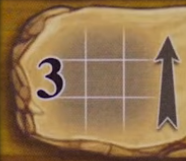

## Overview

This is a worker placement and tile laying game where we are clans of vikings stiving to be the best. At the end of 7 rounds, the player with the most victory points wins

There are a bunch of phases to a round, but most of them are administrative. The bulk of the game happens in the action phase, where we'll be take turns putting out a number of workers on to the board to take an action and block of that spot for the remainder of the round. Most actions will award resources or tiles, which can be used to place on your player board to get income and rewards and block negative points. When you finish your action, the next player takes one, and so on and so on until we've all passed. Then we proceed through the rest of the phases in the round.

## Major Concepts

### Tile Placement

You've got a playerboard with a big grid for laying tiles, and you can also get island boards and buildings that have room for them as well.

Even though this is a worker placement game, that is all in service of getting tiles and filling up your boards.

On your playerboard are some money income spaces (with the hand), bonuses that show different resources or tiles, and a bunch of negative points.

You want to cover up empty spaces, money income spaces, and -1 spaces, while surrounding the bonus icons.

!!! note
    When tiles are earned, they are put into your supply. You can place them onto your playerboard at any time. They don't have to be placed immediately

- Tiles can be placed anywhere, they don't have to be adajcent to other tiles you've placed
- Tiles can't overlap, hang off the grid, or be placed diagonally
- Can not be moved once placed, but you can rotate it around and see how it would fit into different spots before placing it

This icon on the bottom right of your playerboard serves as a reminder for tile placement rules

- Blue and green tiles can be placed on your main playerboard with special rules
    - Green tiles can't be directly adjacent, but diagonal is fine
    - Blue tiles can be adjacent
- Coins, ore cubes, and special gray tiles (treasure board stuff), can also be freely placed without restriction
- You can also get islands and farms, these have reminders in the corner for how tile placement works on them
    - Islands follow the same rules as playerboards
    - Buildings you can place blue and green adjacent, orange and red can also be placed, but not adjacent

### How income works

On your playerboard, island, and farms, there are income symbols with a coin and hand. Every round you'll get a number of coins equal to the lowest uncovered one of these on each of your boards

- To cover an income space, you will first need to cover the spaces to the left and below the symbol in a square
- If you place a tile that covers all of them at the same time, that is fine
- So to cover up the 1 income space on your board you would need to cover the 4 squares in the bottom left. Since the 2 is now the lowest visible, that would be your income.

- Bonus spaces count as being covered, so you do not need to cover their symbol
    - Bonus spaces that are completely surrounded (all 4 sides and diagonals) will earn you the depicted bonus every round

## Actions

In the action phase, whoever has the first player moose will take the first action. THen the next player in turn order will take a single action. Then the next person. We'll keep going around like this until everyone has run out of workers and passed.

- There are a lot of options, but they are broken down into categories for what you're trying to accomplish
- You will take a number of vikings from your player board  tree and put them on the action you want to do
    - The number of workers is determined by the column, counts are shown up top, 1-4
    - Usually the more workers, the stronger the action
    - Third column also draws you a card
    - Fourth column also lets you play a card
    - Fifth column is a little different.
        - You can use one or two workers, and if you use two, you get to play a card for free as well
        - Taking an action here is the last one of your round. If you take one of these actions you are forced to pass for the rest of the round. So try and do it late in the round!
    - Either of these card bonus actions can be done before or after your chosesn main action
- After you carry out your action, the next person in turn order will go and take 1 action
- Action spaces already occupied are blocked

### Gaining stuff

- Some actions just give you stuff
    - Weekly market row gets you tiles. Row 4 worker spot just gives you a coin, an herbs, and a mead
    - Weekly markets space 2 gets you stuff up top, and then additionally grain if you have a horse (more on animals later)
    - Mountain spaces allow you to grab resources. You grab the number shown from a single mountain tile, left to right. You can't split this between multiple mountain tiles unless the space allows.
        - Most of these actions let you take from a single strip. The 3 worker action lets you take from different strips.
        - If a strip is emptied out, it is removed is not replaced until later in the round
- Trade spaces allow you to upgrade tiles. You upgrade tiles by either flipping them over or replacing the tile with one the same size the next color up.
    - Flow is orange > red > green > blue
- Trade action numbers tell you how many tiles you can upgrade, with the arrow indicating how much you can upgrade each tile.
- Example shows upgrading up to 3 different tiles 1 time each.

### Exchange actions

- Some actions with an arrow require you to spend what is on the left to get what is on the right
    - Livestock 2 worker space costs 3 coins to get hay and 1 of any animal
    - Crafting 1 worker space lets you trade a specific yellow tile for a specific green one
- Actions that say "from" give you the depicted reward if you meet the depicted condition (milk from cows)

Some actions let you get gray bonus tiles

- Crafting 4 worker action lets you pay an ore to grab one of the special tiles from the circular board showing the forge tongs icon, or a blue tile with the forge tongs icon

Another set of exchange tiles will get you building tiles and boats

- Build houses row sees you trading resources for specific building tiles or boats
    - Buildings act as a new player board where you can place tiles, and get you additional income and bonuses, as well as potentially gaining or losing you points
    - You start the game with a unique building that you can build instead of the one for the single worker action
    - These are double sided and you can choose whatever side to build
    - Some of these require you to put unique tiles on them, but yield great bonuses

- Boats
    - Boats have several different versions available that are used for different actions
    - Once these are build they'll go into the bay on your playerboard in the spaces matching their outlines.
        - You only have space for so many ships

The different types of boats are required to take some of the different actions. The boats aren't consumed when you take actions requiring them, it is just a check.

- The top row of sailing lets you pay money to upgade any number of different tiles you own, but only if you have that specific type of ship (knarr)
- In this same row there is also a special item purchase. If you have a knarr, you can buy up to 2 items from the larger gray tile board, payuing the collective cost shown on the tiles
    - You cannot buy the crown, you'll have to take it by force

### Weapon actions

We start the game with some weapons that are mainly used for raiding, pillaging, and hunting actions.

These actions will have you rolling the depicted die (d8 or d12) and using weapon cards and resources to try and meet a specfiic number to succeed at the action.

- Raiding and pillaging you want to roll high, as that means you get to take a higher numbered item
- Longships are typically required for these actions, and you can put an ore on them to give them a bonus
- Roll the die up to 3 times. Remember, you want to roll high
    - Every ore on your ship adds +1
    - You can use the depicted cards and resources to also add +1 each
    - Pillaging 2 worker action for instance lets us use stone and sword cards
- You then can grab a gray tile from the treasure board equal to or lower than that number (so a total of 16 for the crown)
- If you can't afford a tile with your points the action is a failure. For the space we were looking at, you'd get a stone, a sword card (taken from the discard first), and get to remove one of your workers from that space. Your turn is still over.

Raiding works similarly to pillaging, you just don't get the ore bonus, and don't return a worker if the action is a failure. You still roll the die up to 3 times though, although a smaller die

Hunting works similary to raiding and pillaging.

- For these actions, you want to roll low instead. 
- You're trying to hit 0, and if you succeed, you get the rewards shown on the action space.
- Roll the die up to 3 times, then when you're happy with the number:
    - Spend the indicated weapons cards and resources to lower the number on the die by 1 each
    - Whaling boats let you use ore to lower the number by one each, and come with an ore printed on the boat
- Failing hunting checks works the same way. Get some compensation stuff and potentially take workers back depending on the action space

### Exploring and emigrating

Additionaly, you can do some less violent things with your boats

- Exploring lets you grab an island board.
    - Based on which action space you pick, you get to pick from the island boards with the exact matching boat arrangment icon. So you can't pick an island that shows a dual boat icon if you take the action showing the triple boat.
    - This board will now be only yours, and you use it just like your playerboard. More places to put stuff, more potential income, bonuses, and points.
- Emigrating
    - All the actions we've talked about so far that require boats just meant you needed to have them to perform the actions. Emigrating makes you spend boats.
    - This lets you give up a boat to flip it over and put it on the feast track. Bigger boats go right on the track, whaling boats trade out for a small emigration token (ones worth 7)
    - It'll be worth end game points, and it means you have less people to feed each round

### Livestock

One type of good you can get through various actions are different kinds of livestock

- These are kept in the barn areas at the bottom of your board
- Animals are checked to get you some resources, or spent to gain you a ton
- They'll also breed later in the round if you have multiple

### Occupation cards

- You start the game with a single starter occupation card
- Some of the actions at the bottom of the board let you draw additional cards, or play cards
- Cards don't have a cost to play, but some could have costs associated with them.
- Cards have different triggers based on the color
    - Blue: Any time
    - Yellow: Immediately when played
    - Orange: Every time a trigger occurs
    - Green: One time, as soon as something happens

There are a bunch of different cards. We won't go over there, but there is an appendix that goes into detail about all of them.

At the top of the board there are reminders:

- Every 3 worker action also draws you a card
- Every 4 worker action also lets you play a card

When you would play an occupation card, you can instead just discard it to gain a victory point toek. These are limited to a couple 4 point tiles, six 3 point tiles, and then eight 2 point tiles

### Free actions

- Placing a tile onto any of your boards from your personal supply
- Placing ore onto your ships
- Using blue occupation cards
- Split coins into smaller denominations
- Use coins to buy ships
    - Instead of taking an action and paying resources for a ship, you can also spend money equal to the points that they're worth to get ships at any time

We're all done talking about actions!!!

## Other phases

This is all tracked on this smaller side board

- 1: Top of the round we'll get a new viking from the hall up top and add them to the worker supply we have.
    - So every round we'll have one more worker
- 2: Harvest
    - If there is a number in the yellow box below the current round number (where the worker was just removed from), we'll get bonus food
    - Grab one of each yellow tile that shows the yellow number
    - So in round one, we'll get three tiles, the string beans, the peas, and the flax (all tiles marked with the 1 bag symbol)
    - Round two we would get those 3 tiles, plus one of each of the yellow tiles with the two on them
- 3: Island stuff
    - In rounds with a letter in the blue box below them we'll flip over the indicated island board if it is still present
    - All other islannd boards will get coins added to them. If you take an island with coins, you get the coins too.
- 4: Each player draws a new weapon card
- 5: Actions phase (we already went over)
- 6: First player: Last person to pass in the action round gets the moose and is the new start player
- 7: Money income: Get the lowest visible amount of money from each of your boards (main, island, building)
- 8: Animal breeding:
    - If you have 2 or more of the same animal, flip one to the pregnant side.
    - If you already have a pregnant animal, flip it back and gain an additional one of that animal
    - Pigs work different, if you have 2 pigs, just get another pig. They don't have a pregnant side. They can also be upgraded into from a tile
- 9: Feast
    - This is where you must feed your people by filling up all the empty sqauares on the part of your board where your unlockable workers are
    - Fill these spaces with orange and red tiles. Same colors can't be adjacent.
    - You can also fill spaces with coins
    - If you would use 2 of the same food, you must rotate the 2nd one 90 degrees
    - So a second mead horn would only take up a single space on the track
    - For each space of your hall you can't fill, you'll take a -3 point penalty token
- 10: Collect bonuses from boards. Tiles and resources spaces that are completely surrounded, but not covered up
- 11: Update mountain strips: 
    - Remove the leftmost resource from each board
    - Discard any empty boards
    - Add a new board and fill it up
- 12: Everyone gets all vikings back

## Scoring:

After the set number of rounds:

- Points for each ship you have
- Points for emigrated tiles (flipped over ones up top)
- Exploration and building boards (top right)
- Livestock points
- Played occupation card points
- Coins leftover
- Get one final coins income
- Points if you have the crown tile

Then add up all negative points

- Visible -1s on player board, island board, buildings, and tokens from missing feeding.

