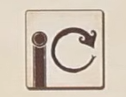
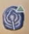
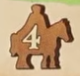
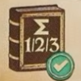
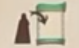
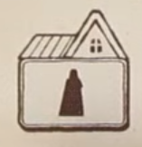

## Overview

This is a worker placement and worker retrieval game where we'll gear up in village to go on adventures, and then come back to taverns to tell tales of our exploits!

## Boards overview

There is a grid of cards that represent the village that we'll be gearing up in

There is a main board that we'll be moving around to go on adventures

- The small tiles with VP around them are quests that we're racing to complete
- The large green tiles are events that will change round to round
- The cards are things that we'll encounter at the different sites around the board

There is also a board that tracks the seasons that we'll all be moving though. The season you're in determines the actions that you can take.

On your playerboard:

- There is a section on the left for income
- A section in the middle for tracking strength (red) and magic (blue)
- A section to hold your quest markers and villagers (workers)
    - We only start with some of our workers available

## Round overview

The game is played over the course of 5 rounds. We'll take turns in clockwise order from the first player.

- The round is played over different seasons. 
- All players begin the round in spring, but we'll progress through the different seasons as the round goes on
- Players can advance to different seasons at different rates, but we'll always stick to the same turn order as the round goes on
- Spring and summer are where you'll be doing actions (different ones in each season)
- Adavancing to autumn gets you income, but will be your last turn of the round. Once all players advance to autumn, the round will be over
- We'll move to winter, which is just clean up before a new round starts with everyone in spring again

## Turn overview

On your turn, you must take an action from those available to you in your current season

- Spring: Place a villager
    - This action is available only in spring
    - You take a villager from your playerboard and put it in the village (the grid of cards)
    - Villagers get placed in the empty spaces, not on cards themselves.
        - Place vilalgers either between 2 adjacent cards, or between a card and an empty card space (where there used to be a card)
    - Multiple villagers can occupy the same space, even multiple from the same player.

- Summer: Retrieve a villager
    - This action is available only in the summer
    - You retrieve villagers to either gain money or activate cards
    - To gain money:
        - Pick one of your villagers and move them to the camp (the blank space on the season board)
        - Then pick one of the two cards it was adjacent to and gain 1 coin for each villager still around that card (regardless of owner)
    - To activate a card
        - Move a villager to the camp
        - Pick one of the two cards it was adjacent to and pay any cost on the card (coin symbol on left side)
        - Pay an additional coin for each villager still around that card (regardless of owner)

### Types of cards

There are a few types of cards that work a little differently. Some have seal tokens on them, and they have different symbols in the bottom right

- Buildings (house symbol in bottom right)
    - Buildings with no seal have no innate cost. Remove your villager then just pay coins for villagers around the card and activate the effect
        - The effect may be free or have a cost associated with it
    - Buildings with seals you will remove your villager, pay any additional villager costs then choose a seal on the card. Remove the seal and resolve the card effect based on the seal you removed
        - Depending on the card the number on the seal could equal a cost you need to pay, or be the number of times you resolve something else
        - After resovling the card the seal is discarded. Buildings can't be activated once all of the seals are gone
- Companions: Blue icon and blue bar
    - Activating a copanion card gains you the card.
        - Pay the coin cost on the card plus any additional villager costs
        - Put the card on the left side of your playerboard
        - Gain the reward in the top right (Will always be to gain a villager from the supply to your playerboard)
        - You can only have up to 3 companions. Once you have 3, you can never gain another. So they're here to stay
    - Companions have a reaction effect on the bottom
        - When you do what is shown in the scroll, exhaust the card by turning it sideways to resolve the effect to the right of the scroll.
        - So these are once per round abilities, cards will be readied again at the end of each round.
    - Some companions also have a passive effect shown next to the cost in the smaller blue box.
        - Passives are always active, whether the card is readied or exhausted
    - Every companion also has and end game scoring listed in their blue bar
- Items: Red icon and red bar
    - Activating an item card gains you the card
        - Pay the coin cost on the card plus any additional villager costs
        - Put the card on the right side of your playerboard
        - Some cards will have an immediate reward in the top right
    - Items can reward victory points in the bottom left if you still have them at the end of the game
    - Potion items will have a reaction effect that works like the one on companions.
        - When thing in scroll happens, discard the potion to gain the reward shown next to the scroll
    - Non potion items will have an action on them that you have to exhaust the card to use.
        - Some of these will require only exhausting the card, others will require you to also send a villager to the camp
    - As a summer action, you can activate one item
    - Some items are one time use

- Like companions, exhausted items will refresh at the end of the round.
- You are also only allowed to have up to 3 items at once.
- Unlike companions, you may freely discard items to make room for new ones

### What effects do

All these cards be doing stuff

Strength and magic

- When you see the red and blue symbols on your playerboard with a little arrow, move your token up on that track
- If a track is maxed out and you gain movement on it, just gain a point instead
- These stats are requirements to do some of the other stuff in the game

Horse icon means to go adventuring

- The number in the horse is the amount you may move up to
- There is a path on the main board with semi circle cldarings that you're moving around
- You can move either direction
- Wherever you end your movement, you can resolve an encounter in that location
- Some spaces you can gain rewards from without interacting with a card. Like the first space could gain you a coin, the second a point
- If there are cards associated with the location, you can interact with one of those instead
    - The requirement for the encounter is shown on the bottom left scroll, with the reward shown on the bottom right scroll
    - If you meet the requirement, take the card from the main board and gain the reward shown. You can't take a card if you don't meet the requirements
    - Requirements with a solid line down the center mean you must meet either or
    - There are two rewards on these double requirement cards, and you gain the reward of each requirement you meet.
    - Some rewards are income tiles that will be added to the left column of your playerboard and gain you bonuses at the end of each round. You CAN have more than 3 of these
    - Slot the encounter card under the top of your board on the book without a check mark
- On the board spaces with a purple, red, and black colored flag, instead of resolving and encounter with a card, you can compelte the attached quest
    - If you pay the cost or meet the requirement, put one of your banners on it for end game scoring. 
    - First player to complete quest puts their banner toekn on the higher point total, with others putting their banner on the lower total
    - These are end game points, you don't get them now

The icon with a book and a checkmark is to tell your stories

- What's the point in adventuring if you don't tell anyone about all the cool shit you did
- This action is generally done at tavern buildings
- In order to do this, you must have untold stoires, or cards tucked under the left book at the top of your playerboard
- Take untold stories whose number adds up to 1, 2, or 3. You care about the sum of the numbers, not the number of cards
- Move those cards to the told stories side of your board (the right with the check)
- Taverns will always show 3 rewards. You gain the first if you told 1 book value worth of stories. You gain the first two rewards if you told 2 book value worth of stories. You gain all three if you told 3 book value worth of stories.
- You are allowed to tell a value 4 story with specifically two 2 value books stories. You still only gain rewards as if it were a value 3 though.
- Stories with a book value of 0 can't be told as part of a taver action. The only way to tell these is with an effect that modifies the value

### Events

Lets talk about another one of the main actions of the game, participating in events

- On the main board on the fancy looking green tile, there is a different event every round
- There are a few different ways you can take this action across spring and summer
    - Both seasons will let you activate the event by placing a villager from your playerboard
    - Summer also lets you activate an event by placing a villager from the village
- Regardless of how you do it, each player may only activate the event once per round

### Other actions

In summer, you may also take a special action 

- Move a villager from the active area on your playerboard to the special action space at the top of that same column
- This lets you pick from 3 options
    - Gain a magic
    - Adventure with a movement value of up to 1
    - Tell stories using the printed rewards
        - These rewards are worse than other ones for telling stories. Why would people at your house care as much as people in the tavern?
- The special action can only be taken once

To recap, we've talked about everything that you can do listed on the season board

- In spring
    - Place out villagers in the village
    - Activate the event by placing a villager
    - Move to summer
- In summer
    - Recall a villager from the village to either get money, gain a card, or activate the event
    - Activate the event by placing a villager
    - Activate a single item card
    - Take a special action 
    - Move to fall

Fall is where we'll get income. 

- Move your adventurer back to the starting space on the main board
- Retrieve your villagers from the event and the camp (space on the season board)
- Retrieve your viallger from special space if you used it
- Ready all exhausted compansions and icons
- Gain income
    - Base income is 3 coins minus 1 for each companion you have (people gotta eat)
    - Income from any additional tiles that you have placed
- Once you've gone to fall you no longer take turns this round
- When everyone has gone to fall, we'll move the the next round

Winter is cleanup/set up for new round

- First player marker will pass clockwise
- Discard all remaning cards from the village
- Discard all unclaimed encounter cards
- Discard the prior rounds event and flip new one
- Deal new 3x3 village, putting new seals onto buildings that require them
- Deal out new encounter cards equal to players + 3, sorting into spots by flag

## End game

- We track points as we play, and when you reach certain spaces you'll get a bonus
- You've got 3 bonus shields. When you hit 8 points, gain the bonus from one of your face up shield tokens and then flip it over.
- 20 gets you another bonus from a faceup shield, but you'll flip them both facedown (so all of them are now face down)

After the 5 round is over, you'll add these points to your running total:

- Points from quests with your seal on them
- Points on item cards
- Objective points from companion cards
- Points for strength and magic
    - 2 points if both skills have reached lvl 3
    - 5 points if they've both reached lvl 5