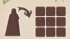
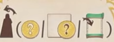

## Overview

This is a worker placement and worker retrieval game where we'll gear up in village to go on adventures, and then come back to taverns to tell tales of our exploits!

## Boards overview

There is a grid of cards that represent the village that we'll be gearing up in

There is a main board that we'll be moving around to go on adventures

- The small tiles with VP around them are quests that we're racing to complete
- The large green tiles are events that will change round to round
- The cards are things that we'll encounter at the different sites around the board

There is also a board that tracks the seasons that we'll all be moving though. The season you're in determines the actions that you can take.

On your playerboard:

- There is a section on the left for income
- A section in the middle for tracking strength (red) and magic (blue)
- A section to hold your quest markers and villagers (workers)
    - We only start with some of our workers available

## Round overview

The game is played over the course of 5 rounds. We'll take turns in clockwise order from the first player.

- The round is played over different seasons. 
- All players begin the round in spring, but we'll progress through the different seasons as the round goes on
- Players can advance to different seasons at different rates, but we'll always stick to the same turn order as the round goes on
- Spring and summer are where you'll be doing actions (different ones in each season)
- Adavancing to autumn gets you income, but will be your last turn of the round. Once all players advance to autumn, the round will be over
- We'll move to winter, which is just clean up before a new round starts with everyone in spring again

## Turn overview

On your turn, you must take an action from those available to you in your current season

- Spring: Place a villager
    - This action is available only in spring
    - You take a villager from your playerboard and put it in the village (the grid of cards)
    - Villagers get placed in the empty spaces, not on cards themselves.
        - Place vilalgers either between 2 adjacent cards, or between a card and an empty card space (where there used to be a card)
    - Multiple villagers can occupy the same space, even multiple from the same player.

- Summer: Retrieve a villager
    - This action is available only in the summer
    - You retrieve villagers to either gain money or activate cards
    - To gain money:
        - Pick one of your villagers and move them to the camp (the blank space on the season board)
        - Then pick one of the two cards it was adjacent to and gain 1 coin for each villager still around that card (regardless of owner)
    - To activate a card
        - Move a villager to the camp
        - Pick one of the two cards it was adjacent to and pay any cost on the card (coin symbol on left side)
        - Pay an additional coin for each villager still around that card (regardless of owner)

### Types of cards

There are a few types of cards that work a little differently. They have different symbols in the bottom right

- Buildings (house symbol in bottom right). Can have a seal symbol in the top right or not
- Companions: Blue icon and blue bar
- Items: Red icon and red bar

