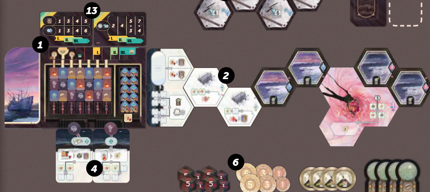
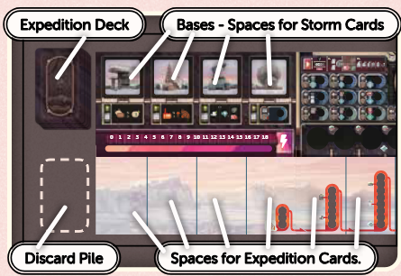

## Overview

We're teams of explorers in Antarctica racing to find a meteorite impact site. When temperatures drop well below freezing, you must consider all the risks!

The game is played over 6 rounds, with a milestone scoring happening at the end of rounds 3, 5, and 6.

## Board overview

- (No. 1) We've got our expert plan board (the one with the ship to the left), filled up with a bunch of experts we can hire
- (No. 4) Below the plan board, we've got some special powers that some of the experts have. Pilot on the left, and mechanic on the right
- (No. 13) Above, we've got a couple common milestones. These are public objectives that everyone will score, and we've all also got private objectives to score.
- (No. 2) To the right, we've got some landscape tiles leading to the meteor crash site, and beyond the crash site some distant landscapes. These make up the board we'll be moving across

## Gameplay overview

Each of the 6 rounds is made up of 3 phases.

- Preparation: Simultaneously we'll draw cards and put them in our tableau
- Planning: Simultaneously we'll get new workers and gain some new cards
- Action: The meat of the game where we'll be operating in turn order to take a single aciton or pass

There will be an additional milestone phase where we'll do scoring after rounds 3, 5, and 6.

### Preparation

We'll all simultaneously do this phase. This is where we'll draw cards from our decks to fill out our tableaus to gain bonuses

During this phase you will draw a card from your deck and then decide to play it face up onto your tableau, or discard it and end this phase. So you will keep drawing and placing cards until you decide to instead discard one and end the phase.

#### Draw cards step

- At the start of the game, your deck is made up of 5 expedition cards and 5 storm cards
    - Expedition cards are played to the bottom part of your tableau (the white spaces). You start the game with three slots available.
    - Storm cards are played to the top part of your tableau, and each must cover a base. You start the game with 3 bases.
- If you draw a card and it has no where to go (like if you've covered up 3 bases with storm cards and draw a 4th storm card), you must discard it and end this step
- There are circular forecast tokens (we each start with one) that you can use during this step
    - Discard a token to take any card from your tableau or the one you just drew and put it into your discard pile. Discarding using this token does not end the step and you may continue drawing and placing cards

#### Expedition bonus

After ending the draw cards step, you gain a bonus from everything on your tableau

- Expedition cards give you rewards based on how many storm cards you've played
    - 0 or 1 storm cards played gets you the top bonus of your expedition cards
    - 2 storm cards played gets you the bottom bonus of your expedition cards
    - 3 or 4 storm cards means you get NO bonus from your expedition cards
- A reminder of this is shown on the bottom right of the expedition cards

- Storm cards get you energy based on how many you've played (the lighting bolt tracker in between your expedition cards and bases/storms)
    - 1 storm card gets you 2 energy
    - 2 storm cards gets you 5 energy
    - 3 or 4 storm cards gets you 11 energy
- A reminder of this is shown on the bottom of the storm cards

- Bases gain you unique bonuses if left uncovered by storms (left to right)
    - Investor Base: 1 coin for each Investor icon on tableau/board. 
        - There is one printed on your board in the expert area on the top right, and one of a card in your starting deck
    - Radio Base: One step on the expedition track for each Radio icon on tableau/board
        - There is one printed on our board in the expert area, and one on a card in your starting deck
        - The expedition track is what frees up slots for cards to go in your tableau
        - Each step moves you up on the track you're currently on
        - If you run out of spaces to go up, move to the next tower (following the arrow)
        - Once you've moved your token to a new track, the previous slot can now hold an additional tableau card
        - If you rach the end you'll be in a little looping space off to the side that gets you additional bonuses
    - The Hanagar Base: Gives you a choice between buying a new station and gaining contruction materials
        - Directly to the right of your energy strack are your stations (the little tent buildings)
            - You can get buy one of these for the cost shown (first one is free)
            - Put it into your supply (the little circle area above it)
        - Instead of a station, you can pay one energy for one constructtion material
            - You can do this a number of times equal to your visible engineer icons
            - You have one in the expert area of your board, and one on a card in your starting deck

So in summary:

- Bases left uncovered will get you bonuses that are powered up by cards in your tableau
- Drawing storms means you block off bonuses and could potentially whiff on cards (radio symbol in your tableau does nothing if you blocked off the radio base with a storm)
- You get energy as compensation for bad storm draws

### Planning

Another simultaneous phase

- Take 2 explorers in your color from the supply and put them in your reserve area (the big empty circle on your player board)
- Each player draws five cards from the deck. You get to keep one for free, or pay 2 energy to keep 2
    - These cards will go into your hand NOT YOUR DECK
    - There are 2 types of cards, expedition cards, and project cards (more on that later)*************************************************************************************************************

### Action

On your turn, you must take 1 action or pass. We'll keep playing like this in clockwise order until all players have passed

#### Activate action space

Worker placement, but the worker stays there for the rest of the game. The action spaces look like a captial H, they're supposed to be your worker's feet.

- Action spaces show up in a bunch of places
    - Expert action tiles (things that show what pilot/mechanic do)
    - Harbor (the side of the main board)
    - Ladscape tiles, station sites, and meteorite ( all the hexes extending off the board)
    - Personal project cards

#### Build a station

#### Upgrade a station

#### Use a radar tile

#### Activate pilot/mechanic

#### Pass