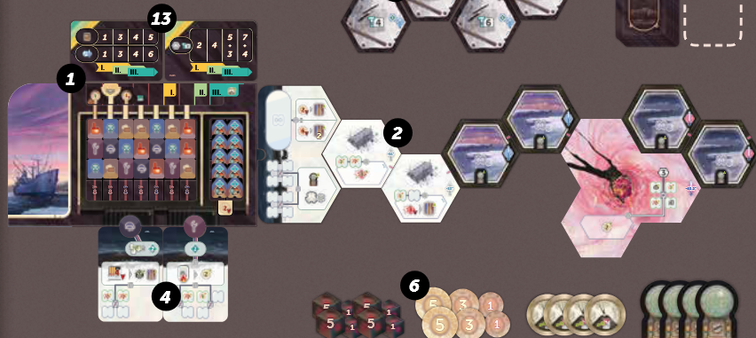
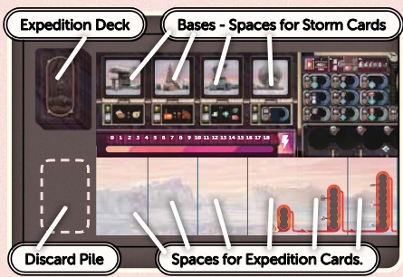

## Overview

We're teams of explorers in Antarctica racing to find a meteorite impact site. When temperatures drop well below freezing, you must consider all the risks!

The game is played over 6 rounds, with a milestone scoring happening at the end of rounds 3, 5, and 6.

## Board overview

- (No. 1) We've got our expert plan board (the one with the ship to the left), filled up with a bunch of experts we can hire
- (No. 4) Below the plan board, we've got some special powers that some of the experts have. Pilot on the left, and mechanic on the right
- (No. 13) Above, we've got a couple common milestones. These are public objectives that everyone will score, and we've all also got private objectives to score.
- (No. 2) To the right, we've got some landscape tiles leading to the meteor crash site, and beyond the crash site some distant landscapes. These make up the board we'll be moving across

## Gameplay overview

Each of the 6 rounds is made up of 3 phases.

- Preparation: Simultaneously we'll draw cards and put them in our tableau
- Planning: Simultaneously we'll get new workers and gain some new cards
- Action: The meat of the game where we'll be operating in turn order to take a single aciton or pass

There will be an additional milestone phase where we'll do scoring after rounds 3, 5, and 6.

### Preparation

We'll all simultaneously do this phase. This is where we'll draw cards from our decks to fill out our tableaus to gain bonuses

During this phase you will draw a card from your deck and then decide to play it face up onto your tableau, or discard it and end this phase. So you will keep drawing and placing cards until you decide to instead discard one and end the phase.

#### Draw cards step

- At the start of the game, your deck is made up of 5 expedition cards and 5 storm cards
    - Expedition cards are played to the bottom part of your tableau (the white spaces). You start the game with three slots available.
    - Storm cards are played to the top part of your tableau, and each must cover a base. You start the game with 3 bases.
- You will always draw a card and decide what to do. Choosing to discard the card ends your draw cards step.
- If you draw a card and it has no where to go (like if you've covered up 3 bases with storm cards and draw a 4th storm card), you must discard it and end this step
- There are circular forecast tokens (we each start with one) that you can use during this step
    - Discard a token to take any card from your tableau or the one you just drew and put it into your discard pile. Discarding using this token does not end the step and you may continue drawing and placing cards

Basically you're trying to maximixe the stuff you play to the bottom of your board while minimizing the amount of storms you cover up bases with. Played cards will synergize with bases, but only if they are storm free.

#### Expedition bonus

After ending the draw cards step, you gain a bonus from everything on your tableau.

- Expedition cards give you rewards based on how many storm cards you've played
    - 0 or 1 storm cards played gets you the top bonus of your expedition cards
    - 2 storm cards played gets you the bottom bonus of your expedition cards
    - 3 or 4 storm cards means you get NO bonus from your expedition cards
- A reminder of this is shown on the bottom right of the expedition cards

- Storm cards get you energy based on how many you've played (the lighting bolt tracker in between your expedition cards and bases/storms)
    - 1 storm card gets you 2 energy
    - 2 storm cards gets you 5 energy
    - 3 or 4 storm cards gets you 11 energy
- A reminder of this is shown on the bottom of the storm cards

- Bases gain you unique bonuses if left uncovered by storms (left to right)
    - Investor Base: 1 coin for each Investor icon on tableau/board. 
        - There is one printed on your board in the expert area on the top right, and one of a card in your starting deck
    - Radio Base: One step on the expedition track for each Radio icon on tableau/board
        - There is one printed on our board in the expert area, and one on a card in your starting deck
        - The expedition track is what frees up slots for cards to go in your tableau
        - Each step moves you up on the track you're currently on
        - If you run out of spaces to go up, move to the next tower (following the arrow)
        - Once you've moved your token to a new track, the previous slot can now hold an additional tableau card
        - If you rach the end you'll be in a little looping space off to the side that gets you additional bonuses
    - The Hanagar Base: Gives you a choice between buying a new station and gaining contruction materials
        - Directly to the right of your energy strack are your stations (the little tent buildings)
            - You can get buy one of these for the cost shown (first one is free)
            - Put it into your supply (the little circle area above it)
        - Instead of a station, you can pay one energy for one constructtion material
            - You can do this a number of times equal to your visible engineer icons
            - You have one in the expert area of your board, and one on a card in your starting deck

So in summary:

- Bases left uncovered will get you bonuses that are powered up by cards in your tableau
- Drawing storms means you block off bonuses and could potentially whiff on cards (radio symbol in your tableau does nothing if you blocked off the radio base with a storm)
- You get energy as compensation for bad storm draws

### Planning

Another simultaneous phase

- Take 2 explorers in your color from the supply and put them in your reserve area (the big empty circle on your player board)
- Each player draws five cards from the deck. You get to keep one for free, or pay 2 energy to keep 2
    - These cards will go into your hand NOT YOUR DECK
    - There are 2 types of cards, expedition cards, and project cards
        - Expedition cards are similar to the ones in your starting deck. They cost energy to play. Can have effects that work with your bases, and grant bonuses based on how few storms you draw
        - Projects cost money and sometimes additional costs (show on bottom). Can give you things like end game scoring or new worker placement spaces

### Action

On your turn, you must take 1 action or pass. We'll keep playing like this in clockwise order until all players have passed

#### Activate action space

Worker placement, but the worker stays there for the rest of the game. The action spaces look like a captial H, they're supposed to be your worker's feet.

- Action spaces show up in a bunch of places
    - Expert action tiles (things that show what pilot/mechanic do)
    - Harbor (the side of the main board)
    - Ladscape tiles, station sites, and meteorite ( all the hexes extending off the board)
    - Personal project cards
- If you cover up a bonus with your worker, you will gain that as well as resolving the action space
- Most action spaces can only hold a specific amount of workers, one per footprint
- Your workers will never return. They get placed out for the rest of the game!

#### Getting experts

The action space on the harbor (to the right of the main board) can hold any number of workers

- The harbor action gives you a couple ways to get experts. One for 2 money or two for 6 money
- Experts are the little rectangular guys in the grid on the main board
- Experts work kind of like great western trail, they'll power up other actions that you're doing
- The round indicator above the grid shows which columns have available experts
    - In the first round you can only buy experts from the first three columns.
    - You get a one coin discount from the first column, no bonus from the 2nd column, and then the third column costs one extra
- You can also get special workers from the right panel called mission coordinators

Placing experts

- On your playerboard you've got columns for each of the 3 basic types of workers that are aligned with other actions. 
- When you gain experts, if they are an investor, radio operator, or engineer, you place them in the appropriate column
- The mission coordinators are wild and can be placed in any column. They'll count as an extra icon of that column.
- Pilots and Mechanics can also be placed in any column, but will NOT count as an extra icon of that cloumn. (more on that later)
- Covering up the icons on your expert track can get you some additional bonuses as well
    - Gain a worker immediately
    - Advance on the expedition track (player board blocking cards) once for each radio icon you ahve
    - Draw 2 cards from the common deck

#### Build a station

#### Upgrade a station

#### Use a radar tile

#### Activate pilot/mechanic

#### Pass

### End of the round

At the end of round 3, 5, and 6, you'll have to pick a milestone to score immediately.

- You have three milestones available to choose from. The 2 shared ones on the main board and your personal one.
- You will pick one to score now and assign your first milestone marker to that card.
- Once you've assigned a milestone marker to a card, you can't assign one of your later ones to the same card.
- When you score your milestone, you'll check two columns depending on the round and see how you did
    - Left two columns for the first scoring
    - Middle two columns for the second scoring
    - Right two columns for the third scoring
- If you met the lower condition, cover it with your milestone marker on the lower point side
- If you met the higher condition, cover it with the higher point side
- If you don't at least meet the lower condiiton, you just put your marker back in the box and cry

So you will be scoring all 3 of the objectives available to you, you just get to choose in what order. The earlier ones will require less investment, with the later ones requiring more investment